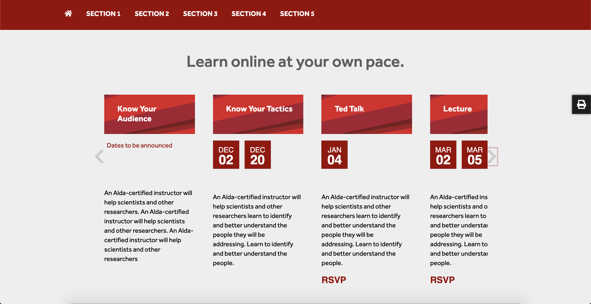
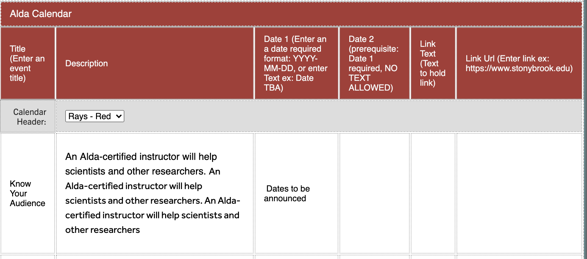

## Alda Center Calendar Snippet

# AldaCenter Calendar Carousel

A dynamic calendar/event carousel component built for Stony Brook University's website during a Software Engineering internship in the Communications & Marketing Dept.

## What This Project Accomplished

- Built a reusable, dynamic component to list and display upcoming events in a calendar-style carousel
- Designed the component to render each event with a title, month/day date, description, and an optional link, making it flexible enough for the Communications team to manage without custom code changes per event
- Shipped the component into Stony Brook University's live website, where it's used to surface upcoming campus events to visitors

## Technologies Used

- **Language:** JavaScript
- **Context:** Built and deployed within Stony Brook University's production website

## What I Learned

Building a component meant to be reused and repopulated with new event data (rather than a one-off page) pushed me to think about configurability and content flexibility, not just a single hardcoded UI — an early lesson in designing for maintainability.
